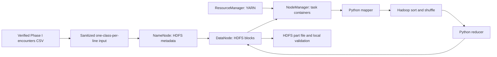

# Phase V local Hadoop architecture

The Compose definition describes **one laptop cluster**, with one NameNode, one DataNode, one ResourceManager and one NodeManager. It is neither a multi-machine deployment nor a scalability benchmark. NameNode stores HDFS metadata; DataNode stores blocks; ResourceManager schedules a YARN application; NodeManager runs its containers; Hadoop Streaming runs the Python mapper and reducer.

The one-shot `hadoop-volume-init` helper sets ownership of the two named HDFS volumes and formats a NameNode volume only when it is empty. It leaves an already formatted volume intact and refuses a nonempty unformatted volume. The Intel Mac run verified one live DataNode and one running YARN NodeManager; see `PHASE5_VERIFICATION.md`.

Source image: [Apache Hadoop 3.4.3](https://hub.docker.com/r/apache/hadoop/tags), based on Apache's [single-node Compose example and configuration](https://github.com/apache/hadoop/tree/docker-hadoop-3.4.3). The published image is Ubuntu 22.04 and already includes Python 3 for Hadoop Streaming. The Apache tag lists `linux/amd64`; it is suitable for this Intel Mac and an x64 Windows Docker Linux backend. ARM is not claimed as native support. MongoDB uses the official [multi-platform `mongo:7.0.41-jammy` image](https://hub.docker.com/_/mongo/tags?name=7.0.41-jammy).

Local URLs once running: NameNode `http://127.0.0.1:9870`, YARN `http://127.0.0.1:8088`, MongoDB `mongodb://127.0.0.1:27017`. Ports bind only to loopback. MongoDB has no authentication in this local demonstration profile, so do not expose it to a network. Named volumes preserve MongoDB, NameNode and DataNode state. Docker Desktop should have at least 8 GB memory available; actual host RAM could not be read under this sandbox, and Docker allocation must be checked before a run. See `docker/compose.bigdata.yml` for per-service memory caps.
