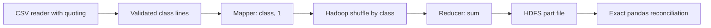

# Phase V MapReduce workflow

The source is the checksummed Phase I `synthea_encounters.csv`, 53,346 **synthetic encounters**. `prepare_input.py` validates its full schema, count, target-free content and SHA-256, then writes exactly one encounter class per line. It rejects missing classes and embedded tabs/newlines. This prevalidated format avoids incorrect naive CSV splitting when Hadoop distributes byte ranges. The source header is not written; the mapper rejects a stray `ENCOUNTERCLASS` header. Each class line maps to `class\t1`; Hadoop sorts and groups keys; the reducer sums unit values. Invalid mapper rows or out-of-order reducer input fail the job.

The Python driver `big_data/hadoop/run_job.py` uploads to `/mediscope/input/encounter_classes.txt`, lists the HDFS directory, removes only its prior output path, invokes the actual Streaming JAR through YARN, retrieves the HDFS part file, and checks every class against pandas. It writes `reports/bigdata/hadoop_job.log`, `hadoop_encounter_counts.tsv` and `hadoop_verification.json` only after the corresponding steps. A failed run raises an error and cannot be marked successful. The shell wrapper is for macOS/Linux; the CLI driver works through `subprocess` on Windows too.

On the local Intel Mac, HDFS upload/list/read, YARN execution, reducer retrieval and exact pandas reconciliation passed. The live job log, reducer table and verification JSON are in `reports/bigdata/`. The separate source-only reference counts in `source_reference.json` remain labeled as pandas results.
