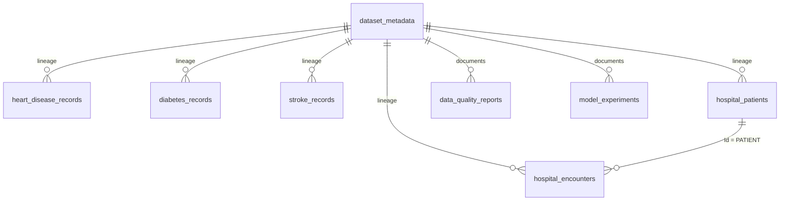

# Phase V MongoDB schema

Database: `mediscope_healthcare`. All imported records include `_id` (string), `source_dataset` (string), `source_sha256` (SHA-256 hex string), `source_row` (1-based integer), and `synthetic` (boolean). `_id` is `dataset:source-row` for heart and diabetes, `stroke:source-id` for stroke, and `patients:UUID` or `encounters:UUID` for Synthea. This preserves all 269 identical diabetes observations while making reruns idempotent. Imported records are insert-only; a changed source hash requires review. Source CSVs are immutable.

| Collection | Fields beyond common lineage fields | Key / relationship | Indexes |
|---|---|---|---|
| `dataset_metadata` | source path, original URL, raw and prepared SHA-256, license, provenance, row count | `_id`: dataset name | `_id` |
| `heart_disease_records` | all 15 Phase I heart columns; numeric measurements as number, codes as source string or number, nulls as BSON null | `_id`: row ordinal | target |
| `diabetes_records` | all 17 questionnaire columns; `Age` number, symptoms/Gender/class strings | `_id`: row ordinal | class |
| `stroke_records` | all 12 Phase I stroke columns; measurements/numeric flags as number, categories strings, missing BMI/smoking response null | `_id`: source `id` | stroke |
| `hospital_patients` | `Id`, `BIRTHDATE`, `DEATHDATE`, `MARITAL`, `RACE`, `ETHNICITY`, `GENDER` strings/null; expense and coverage numbers/null | `_id`: synthetic patient UUID | gender, race |
| `hospital_encounters` | `Id`, `START`, `STOP`, `PATIENT`, `ENCOUNTERCLASS`, `CODE`, `DESCRIPTION`, `REASONCODE`, `REASONDESCRIPTION` strings/null; costs numbers/null | `_id`: synthetic encounter UUID; `PATIENT` references `hospital_patients.Id` | patient, class, start |
| `data_quality_reports` | `report` object from Phase I quality JSON | `_id`: registry dataset ID | `_id` |
| `model_experiments` | source dataset, registry SHA-256, selected model, experiment count, research-only flag | `_id`: heart/diabetes/stroke | `_id` |

The synthetic patient import deliberately omits SSN, driver's license, passport, name, birthplace, address, location and ZIP. The encounter import omits organization, provider and payer identifiers. All hospital rows are labeled `synthetic: true`. Dates remain ISO strings so they match the validated prepared tables; monthly queries use the first seven characters of `START`. Missing values become BSON null, never text `"nan"`.

For field-level source definitions, ordered schemas, provenance uncertainty and terms, see `data/metadata/datasets.json` and `docs/DATA_SOURCES.md`. The import checks each prepared CSV SHA-256 against its Phase I quality manifest. No claim is made that source archives' recorded hashes prove an acquisition date.

